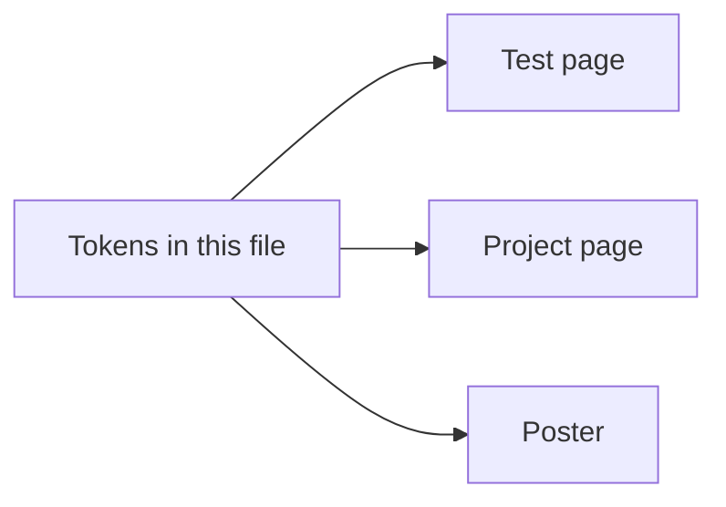

# DESIGN.md

Direction: **Matches aher.dev (owner's portfolio and blog).** Light page, Inter, ink text, grey secondary text, hairline borders, blue only for links and one pill. Every chart sits on a dark rounded stage with outlined marks, like the blog figures. Changed 23 Nov 2026 at the owner's request: no AI-looking colours.

Why this picture: all three surfaces read the same tokens, so they look like one project.

| Token | Light | Dark | Role |
|---|---|---|---|
| bg | #FAFAFA | n/a | Page ground (light only, like aher.dev) |
| surface | #FFFFFF | n/a | Cards |
| ink | #0A0A0A | n/a | Text |
| muted | #737373 | n/a | Secondary text |
| link | #2563EB | n/a | Links and the course pill only |
| me (chart) | #56C7E3 | on #0D1117 stage | Cyan: really me |
| twin (chart) | #F2766B | on #0D1117 stage | Coral: the AI twin |

- **Type:** Inter 400, 500, 600 (matches aher.dev). Headings are plain declarative sentences under a small uppercase label.
- **Space and line:** 4 px scale, 6 px radius, hairline borders, no shadows.
- **Colour rule:** cobalt always means me, orange always means the twin.
- **Icons and imagery:** none; the numbers and the quoted lines are the imagery.
- **Copy voice:** short plain sentences, first person, no hype words.
- **Forbidden:** gradients, glass, emoji, centred hero with feature cards, purple.
- **Status:** tokens are shared by the page, test, poster and report; the page was checked at 375 and 1440 px, dark theme shown; light theme not screenshotted yet.
