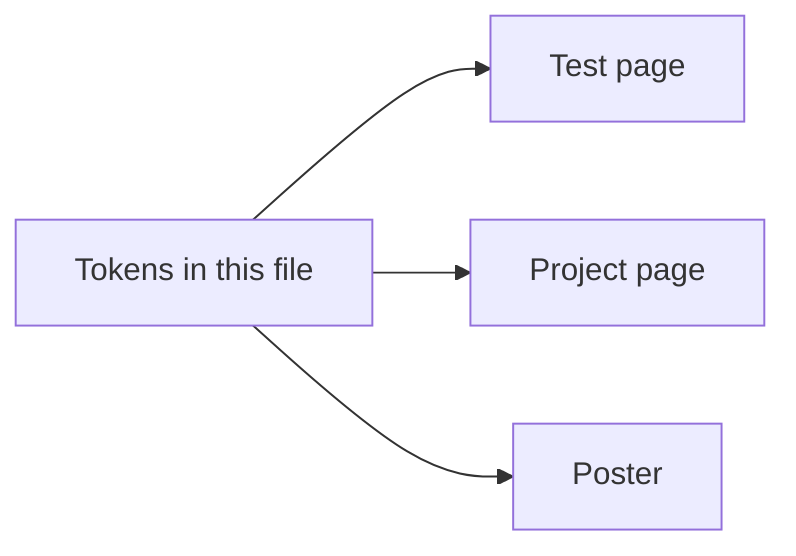

# DESIGN.md

Direction: **Swiss editorial data sheet.** One column of plain statements, one dark block holding the single number that matters, evidence underneath.

Why this picture: all three surfaces read the same tokens, so they look like one project.

| Token | Light | Dark | Role |
|---|---|---|---|
| bg | #EEF1F4 | #0F141B | Page ground, a cool paper grey |
| surface | #FFFFFF | #182029 | Cards and inputs |
| ink | #131A24 | #E9EEF4 | Text and the result block |
| muted | #4D5968 | #9AA7B6 | Captions |
| accent | #1F4FD8 | #7FA2FF | Cobalt: actions and "really me" |
| twin | #B34E14 | #F0A067 | Burnt orange: anything written by the AI |

- **Type:** Bricolage Grotesque (display, 500 and 700) with Instrument Sans (body), both from Google Fonts.
- **Space and line:** 4 px scale, 6 px radius, hairline borders, no shadows.
- **Colour rule:** cobalt always means me, orange always means the twin.
- **Icons and imagery:** none; the numbers and the quoted lines are the imagery.
- **Copy voice:** short plain sentences, first person, no hype words.
- **Forbidden:** gradients, glass, emoji, centred hero with feature cards, purple.
- **Not yet done:** reference study, a mock reviewed before build, and the critique and accessibility passes. The pages were built directly under deadline.
