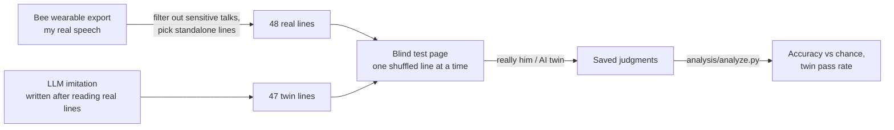

# Me or the Machine

**If an AI writes one sentence in my voice, can the people closest to me tell it is not me?**

Final project for AIPI 590 (Responsible AI), Duke University, Fall 2026. Author: Jaideep Aher.
Course topics: red-teaming, AI harms, human-AI interaction, AI evaluation.

## Result so far (pilot)

Four people who know me judged 100 single lines as "really him" or "AI twin". They were right 51 times: **51%, where a coin flip gets 50%** (95% interval 41% to 61%, exact binomial p = 0.92). My real lines were called "him" 60% of the time and the twin's lines 58% of the time.


Why this picture: it shows where each kind of line comes from and that judges only ever see one unlabeled line at a time.

## What is in this repository

| Path | What it is |
|---|---|
| `data/lines.json` | All 95 lines with id, set (A, B, C; set D is a fixed 20 drawn from these) and source (real or twin) |
| `data/results.json` | Anonymised judgments from each participant |
| `analysis/analyze.py` | Accuracy, twin pass rate, exact binomial test, Wilson intervals (standard library only) |
| `analysis/summary.json` | Output of the script |
| `app/me-or-machine.html` | The test as published privately on claude.ai (saves to the page's own store) |
| `public-test/index.html` | The public 20-line test friends open on their own phones (saves to a database) |
| `site/index.html` | The project web page |
| `poster/poster.html`, `poster/poster_24x24.pdf` | The 24 by 24 inch poster and its source |
| `DESIGN.md` | Visual tokens shared by the page, the test and the poster |
| `docs/decisions.md` | Dated design decisions and rejected options |

## Run it

Requirements: Python 3.9 or newer for the analysis; any browser for the pages; Google Chrome to rebuild the poster. No packages to install and no model downloads.

```bash
python3 analysis/analyze.py
```

```bash
open site/index.html
```

```bash
"/Applications/Google Chrome.app/Contents/MacOS/Google Chrome" --headless=new --no-pdf-header-footer --print-to-pdf=poster/poster_24x24.pdf "file://$PWD/poster/poster.html"
```

The public test posts each finished round to a Supabase table (`me_or_machine_results`) that anyone may insert into and nobody may read without the owner's login. To use your own database, change the URL and publishable key near the top of the script in `public-test/index.html` and create the table from `docs/decisions.md`.

## Data and API requirements

- **Real lines** come from my own Bee wearable export, which is not in this repository. Only the 48 chosen lines are included. They are speech-to-text and keep its recognition errors.
- **Twin lines** were written by Claude (Opus) inside a chat session, after it had read the real lines. No API key is needed to reproduce the analysis. Regenerating twin lines with a script is future work.
- **Judgments** are stored with participant labels P1, P2 and so on. Names stay out of the repository.

## Design decisions

- **Single lines, not pairs.** The first version showed a real and a twin line on the same topic. Judges found it tiring, and Bee's interleaved transcripts made "question then reply" pairs unreliable.
- **No answers until the end**, and shuffled order, so a judge cannot learn my style during the round.
- **Sensitive conversations are excluded** before any line is picked: relationships, health, family, money. Lines naming other people are excluded too.
- **Informed judges.** Everyone is told some lines are AI-written before starting. Nothing was ever sent to anyone as me.

## Known limitations

- Four judges and 100 judgments across four different line sets. This is a pilot.
- One judge was on a third attempt and had seen some lines before.
- A single sentence carries little identity, so chance-level accuracy may reflect the format as much as the twin.
- The twin lines were hand-prompted in a chat with the real lines in view. There is no control twin that knows nothing about me yet, so the study cannot say how much my personal data contributed.
- Real lines contain transcription errors that may make them look less like me.
- Other people's speech appears in my raw recordings. It was never used, but they did not consent to being recorded for a study, which limits what raw data can ever be shared.

## Misuse and stakeholders

A convincing twin is an impersonation tool. This repository ships no automated twin, sends no messages, and holds only benign one-liners. The people most exposed are friends and family of anyone whose assistant holds their data; the result suggests that "I would know if it wasn't them" is not a safe assumption for short messages.

## Future work

1. A control twin with no data about me, to measure what personal data adds.
2. One fixed set judged by ten or more people, with a reason for each answer.
3. Multi-turn exchanges, where shared history should help the judge.
4. A defence: a shared phrase or question that a twin without lived memory fails.

## Related work

- Turing, A. (1950). Computing Machinery and Intelligence.
- Jones, C. and Bergen, B. (2025). Large Language Models Pass the Turing Test.
- Park, J. S. et al. (2024). Generative Agent Simulations of 1,000 People.
