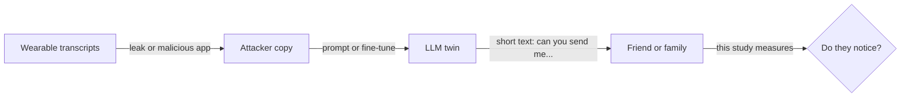
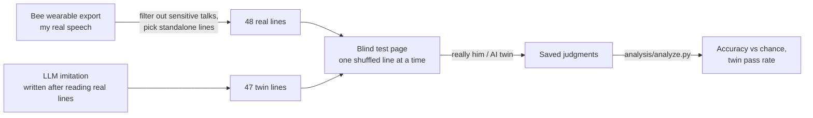
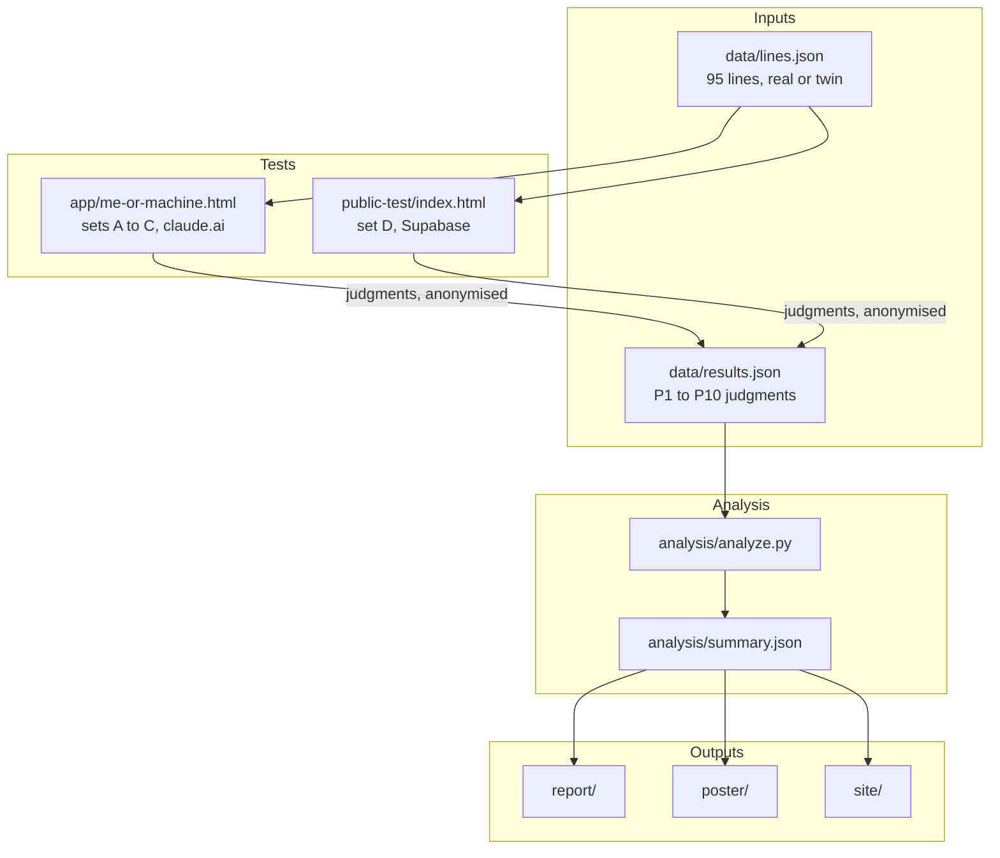

# Me or the Machine

**If an AI writes one sentence in my voice, can the people closest to me tell it is not me?**

Final project for AIPI 590 (Responsible AI), Duke University, Fall 2026. Author: Jaideep Aher.
Course topics: red-teaming, AI harms, human-AI interaction, AI evaluation.

| Deliverable | Where |
|---|---|
| Report (submit this) | [`report/report.pdf`](report/report.pdf) |
| Poster, 24 by 24 inch | [`poster/poster_24x24.pdf`](poster/poster_24x24.pdf) |
| Project page | https://jaideep-aher.github.io/me-or-the-machine-site/ |
| Live 20-line test | https://jaideep-aher.github.io/me-or-the-machine-site/play/ |

## Goal and threat

Recording pendants (Plaud reports 2M+ sold; Amazon bought Bee in July 2025, Meta bought Limitless in December 2025) hold months of how their owners talk. The FBI's 2025 Internet Crime Report counted 22,000+ AI-enabled scam complaints and about $893M in losses. The goal is to test whether the people closest to someone are a real safeguard when an AI built from that speech writes as them.


Why this picture: the attack chain, and the one step this study tests.

## Result so far (pilot)

Ten people who know me judged single lines as "really him" or "AI twin". On the 160 judgments with saved answers they were right 78 times: **49%, a coin flip** (95% interval 41% to 56%, exact binomial p = 0.81; averaged per judge, also 49%). Adding three friends' reported scores gives 111 of 250 (44%). Twin lines were called "him" as often as my real ones (47 and 45 of 80). Four judges saw the same 20 lines and agreed unanimously on one, a twin line they all believed.


Why this picture: it shows where each kind of line comes from and that judges only ever see one unlabeled line at a time.

## What is in this repository


Why this picture: lines feed the two tests, judgments feed one script, and every number in the report, poster and page comes from its output.

| Path | What it is | How it was made |
|---|---|---|
| `data/lines.json` | All 95 lines with id, set (A, B, C; set D is a fixed 20 drawn from these) and source | Real lines filtered by hand-written rules from my Bee export; twin lines written by Claude after reading them |
| `data/results.json` | Anonymised judgments from each participant | Exported from the two tests, names replaced with P1 to P10. P8 to P10 are score-only rounds (reported, rounded; no per-line answers) |
| `analysis/analyze.py` | Accuracy, twin pass rate, exact binomial test, Wilson intervals | Python standard library only |
| `analysis/summary.json` | Output of the script | `python3 analysis/analyze.py` |
| `app/me-or-machine.html` | The test as published privately on claude.ai (sets A to C) | Single HTML page using the artifact's own data store |
| `public-test/index.html` | The public 20-line test friends open on their phones (set D) | Static page that inserts into an insert-only Supabase table |
| `site/index.html` | The project web page (goal, threat, results) | Static HTML, served by GitHub Pages from a separate public repo |
| `poster/` | `poster.html` source, `poster_24x24.pdf`, `preview.png` | HTML printed to PDF with headless Chrome |
| `report/` | `report.html` source and `report.pdf` | HTML printed to PDF with headless Chrome |
| `samples/pilot10.json` | The first 10 topic-matched pairs (abandoned format) | Kept to show the design change |
| `DESIGN.md` | Colours and type shared by the page, test, poster and report | |
| `docs/decisions.md` | Dated design decisions, rejected options, database schema | |
| `docs/review/` | Two rounds of self-review: roast, audit and rubric grade | |
| `site/template.html`, `site/build.py` | Page source and the script that fills its charts from `data/` and `analysis/summary.json` | `python3 site/build.py` |

## Run it

Requirements: Python 3.9 or newer for the analysis; any browser for the pages; Google Chrome to rebuild the poster. No packages to install and no model downloads.

```bash
python3 analysis/analyze.py
```

```bash
open site/index.html
```

```bash
"/Applications/Google Chrome.app/Contents/MacOS/Google Chrome" --headless=new --no-pdf-header-footer --print-to-pdf=poster/poster_24x24.pdf "file://$PWD/poster/poster.html"
```

```bash
"/Applications/Google Chrome.app/Contents/MacOS/Google Chrome" --headless=new --no-pdf-header-footer --print-to-pdf=report/report.pdf "file://$PWD/report/report.html"
```

The public test posts each finished round to a Supabase table (`me_or_machine_results`) that anyone may insert into and nobody may read without the owner's login. To use your own database, change the URL and publishable key near the top of the script in `public-test/index.html` and create the table from `docs/decisions.md`.

## Data and API requirements

- **Real lines** come from my own Bee wearable export, which is not in this repository. Only the 48 chosen lines are included. They are speech-to-text and keep its recognition errors.
- **Twin lines** were written by a language model (Claude Opus) inside a chat session, after it had read the real lines. No API key is needed to reproduce the analysis. Regenerating twin lines with a script is future work.
- **Judgments** are stored with participant labels P1, P2 and so on. Names stay out of the repository.

## Design decisions

- **Single lines, not pairs.** The first version showed a real and a twin line on the same topic. Judges found it tiring, and Bee's interleaved transcripts made "question then reply" pairs unreliable.
- **No answers until the end**, and shuffled order, so a judge cannot learn my style during the round.
- **Sensitive conversations are excluded** before any line is picked: relationships, health, family, money. Lines naming other people are excluded too.
- **Informed judges.** Everyone is told some lines are AI-written before starting. Nothing was ever sent to anyone as me.

## Known limitations

- Ten judges and 250 judgments. This is a pilot.
- Three 30-line scores (P8 to P10) were reported verbally and rounded to the nearest possible score; their per-line answers were not saved, so they count only towards overall accuracy.
- One judge was on a third attempt and had seen some lines before.
- A single sentence carries little identity, so chance-level accuracy may reflect the format as much as the twin.
- The twin lines were hand-prompted in a chat with the real lines in view. There is no control twin that knows nothing about me yet, so the study cannot say how much my personal data contributed.
- Real lines contain transcription errors that may make them look less like me.
- Other people's speech appears in my raw recordings. It was never used, but they did not consent to being recorded for a study, which limits what raw data can ever be shared.

## Misuse and stakeholders

A convincing twin is an impersonation tool. This repository ships no automated twin, sends no messages, and holds only benign one-liners. The people most exposed are friends and family of anyone whose assistant holds their data; the result suggests that "I would know if it wasn't them" is not a safe assumption for short messages.

## Future work

1. A control twin with no data about me, to measure what personal data adds.
2. One fixed set judged by twenty people, with a reason for each answer.
3. Multi-turn exchanges, where shared history should help the judge.
4. A defence: a shared phrase or question that a twin without lived memory fails.

## Related work

- Turing, A. (1950). Computing Machinery and Intelligence.
- Jones, C. and Bergen, B. (2025). Large Language Models Pass the Turing Test.
- Park, J. S. et al. (2024). Generative Agent Simulations of 1,000 People.
