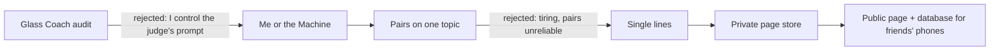

# Decisions


Why this picture: the order in which the design changed and why.

| Date | Decision | Why | Rejected |
|---|---|---|---|
| 22 Nov 2026 | Project is the twin test, suggested by the professor | Friends are the judges, so the builder cannot tune the outcome | Auditing my own coach's judge |
| 22 Nov 2026 | Real lines come from the existing Bee export | Already on disk; no manual export needed | WhatsApp export |
| 22 Nov 2026 | Single lines, shuffled, no answers until the end | Judges disliked pairs; no learning during a round | Topic-matched pairs |
| 22 Nov 2026 | Sensitive conversations and lines naming people are excluded | Owner's rule: nothing confidential | |
| 22 Nov 2026 | Repository is private, shared with instructors | Owner's choice | Public repository |
| 22 Nov 2026 | Public test stores results in a Supabase table inside the existing `campus-closet` project | Friends have no Claude account; no new paid project | A new Supabase project |
| 22 Nov 2026 | Public test uses one fixed set of 20 lines (set D) | Several judges on the same lines gives per-line statistics | Random deal per friend |

## Results table

```sql
create table public.me_or_machine_results (
  id bigint generated always as identity primary key,
  created_at timestamptz not null default now(),
  friend text not null check (char_length(friend) between 1 and 40),
  set_name text not null check (char_length(set_name) <= 4),
  score int not null, total int not null,
  answers jsonb not null check (pg_column_size(answers) < 8000)
);
alter table public.me_or_machine_results enable row level security;
create policy "anyone can submit a result" on public.me_or_machine_results for insert to anon with check (true);
```
