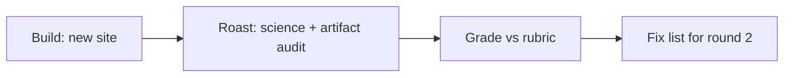

# Review round 1 (23 Nov 2026)

Why this picture: the order of one review round; critics only read, fixes come after the grade.

## Roast: science and design

| Sev | Area | Flaw | Evidence | Fix |
|---|---|---|---|---|
| High | Headline | The 44% headline mixes 90 decisions I never saw (P8 to P10, scores reported verbally and rounded) with 160 saved ones. The 6-of-30 score alone pulls it from 49% to 44%. | `analysis/summary.json`: per-line 78/160 = 48.8%; all 111/250 = 44.4% | Headline on the 160 saved decisions (49%); show 44% only as "including three reported scores" |
| High | Overclaim | "The twin passed more often than I did" rests on 47 vs 45 of 80, a gap of two answers (z = 0.32). | recomputed from `data/results.json` | Say "as often as I did" |
| Medium | Overclaim | "P10 applied a rule backwards (p = 0.001)" builds a mechanism on a rounded verbal score with no saved answers. | `data/results.json` P10 `score_only` | State it as "if the reported score is right"; drop the mechanism |
| Medium | Statistics | The binomial test treats 250 decisions as independent; they are clustered within judges and lines. | `analysis/analyze.py` | Add a judge-level test: 10 judge accuracies, 1 above 50%, 5 below, 4 at 50% |
| Medium | Validity | The 20-line test ships the real/twin label of every line in the page source; a curious friend could check. | `public-test/index.html` lines 129 to 186 | Encode the labels so they are not readable in view-source |
| Medium | Selection | Real lines were picked for being standalone, which may favour generic lines that a twin can easily copy. | `README.md` data section | Add to limits |
| Low | Exclusions | Two database rows ("try 2", "g") are excluded without a written reason. | Supabase rows 2 and 4 | Record the exclusion rule in `docs/decisions.md` |
| Open | Design | No control twin, so the study cannot say what my personal data added. | report section 5 | Out of scope for this deadline; stays in "next" |

## Audit: artifact

| Sev | Location | Problem | Fix |
|---|---|---|---|
| High | Poster footer | The only link is the private repo; an outsider cannot open it and there is no QR code. | QR code and URL for the public site |
| Medium | `site/template.html` | Names the model ("An AI (Claude)") in public copy | "A language model" |
| Medium | Site "Why it matters" | "Pendants went mainstream in a year" is not supported by a source | "are now sold by the million" |
| Low | `DESIGN.md` | Internal note about deadline shortcuts | Rewrite as a plain status line |
| Low | `site/` | Build copies (`play/`, PDFs) would duplicate files in the private repo | Ignore them in git |
| Pass | Commits | All commits carry my name only | |
| Pass | Privacy | Raw files with first names are ignored by git; judges are P1 to P10 | |

## Grade (projected, out of 250)

| Section | Max | Score | Lost points and how to recover them |
|---|---|---|---|
| Poster | 50 | 40 | No resolvable link or QR (-5); headline mixes unverified scores (-3); one overclaim (-2) |
| Artifact | 100 | 86 | Labels readable in test source (-5); model named in public copy and an unsourced claim (-4); clutter (-2); live test not re-checked end to end (-3) |
| Rigor and evaluation | 75 | 55 | Headline on unverified data (-6); independence ignored (-5); two overclaims (-5); no control twin (-4) |
| Creativity | 25 | 22 | Strong premise and live test; no interactive line-by-line exploration (-3) |
| **Total** | **250** | **203** | |
