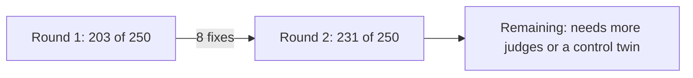

# Review round 2 (23 Nov 2026)

Why this picture: what changed between rounds and why the loop stops here.

## Round 1 fixes, checked

| Round 1 finding | Status | Evidence |
|---|---|---|
| Headline mixed unverified scores | Fixed: headline is 78 of 160 saved (49%); 111 of 250 shown as secondary | poster hero, site "What we found", report abstract |
| "Twin passed more often" overclaim | Fixed: "as often as mine", d′ = −0.06 | poster, site, report |
| P10 mechanism overclaim | Fixed: stated as unverified | poster, site, report |
| Independence ignored | Fixed: judge-level mean 49%, bootstrap over judges 43% to 56%, sign test p = 0.63 | `analysis/summary.json` `judge_level_saved` |
| Labels readable in test source | Fixed: only the 20 test lines ship, labels masked; decoded labels match `data/lines.json` (0 mismatches) | `public-test/index.html` |
| Selection bias unstated | Fixed: added to limits | site footer, report section 5 |
| Exclusions undocumented | Fixed | `docs/decisions.md` |
| Poster had no resolvable link | Fixed: QR code decodes to https://jaideep-aher.github.io/me-or-the-machine-site/ (checked with a barcode decoder on the rendered poster) | `poster/preview.png` |
| Model named in site copy, unsourced claim | Fixed | `site/template.html` |

## New roast findings

| Sev | Area | Finding | Owner |
|---|---|---|---|
| Medium | Rigor | Still no control twin; the study cannot say what my personal data added | Next step, out of scope for this deadline |
| Medium | Rigor | Seven judges with saved answers; the interval is wide (41% to 56%) | Me: more friends on the 20-line test |
| Low | Site | Light theme not screenshotted | Builder, next round |
| Low | Test page | Missing favicon returns a 404 in the console | Builder |

No new Critical or High findings.

## Grade (projected, out of 250)

| Section | Max | Round 1 | Round 2 | Remaining loss |
|---|---|---|---|---|
| Poster | 50 | 40 | 47 | Dense for a 5-minute read (-3) |
| Artifact | 100 | 86 | 95 | Light theme unchecked, small polish (-5) |
| Rigor and evaluation | 75 | 55 | 66 | No control twin (-5), small sample (-4) |
| Creativity | 25 | 22 | 23 | |
| **Total** | **250** | **203** | **231** | |

Stopping after this round: no new Critical or High findings, and the remaining points need more judges or a new twin condition.
