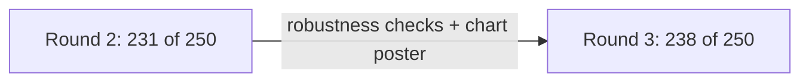

# Review round 3 (23 Nov 2026)

Why this picture: what this round added and where the score moved.

## What changed

| Change | Evidence |
|---|---|
| Power, equivalence test, Bayes factor, Fleiss' kappa, machine style detector | `analysis/rigor.py`, `analysis/rigor.json`, report section 3.1 |
| Poster rebuilt with five charts drawn from the data files | `poster/build_poster.py`, `poster/preview.png` |
| Poster QR code checked: decodes to https://jaideep-aher.github.io/me-or-the-machine-site/ | barcode decoder on the rendered preview |

## Grade (projected, out of 250)

| Section | Max | Round 2 | Round 3 | Remaining loss |
|---|---|---|---|---|
| Poster | 50 | 47 | 49 | Dense in places (-1) |
| Artifact | 100 | 95 | 95 | Light theme of the page not screenshotted (-5) |
| Rigor and evaluation | 75 | 66 | 71 | No control twin (-4) |
| Creativity | 25 | 23 | 23 | |
| **Total** | **250** | **231** | **238** | |

The remaining points need a control-twin condition with new judges.
