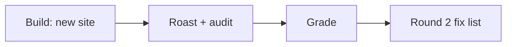

# Review, round 1 (23 Nov 2026)

Rubric used: Poster 50, Artifact 100, Rigor and evaluation 75, Creativity 25 (total 250, target 250). The course gave these section totals only, so the line items below are my own split of each section.

Why this picture: the order of this review loop.

## Roast: science and design

Recomputed from `data/results.json`: 111 of 250 right overall; 78 of 160 where answers were saved; per-judge accuracy (saved) 50, 70, 40, 50, 45, 50, 40%; across all ten judges 1 above 50%, 5 below, 4 at exactly 50%. Pooled hit rate 45/80, false-alarm rate 47/80: d' = -0.06, criterion c = -0.19 (a lean towards "him").

| Severity | Flaw | Evidence | Fix |
|---|---|---|---|
| High | The headline 44% depends on three scores that were reported verbally and rounded, with no saved answers | P8 to P10 in `data/results.json` are `score_only` | Make the 160 saved judgments the primary analysis (48.8%); show 250 as a sensitivity check |
| High | The binomial test treats 250 judgments as independent, but they cluster within 10 judges | `analysis/analyze.py` pools everything | Add a judge-level test (one accuracy per judge, sign test and t-test against 50%) and a judge-clustered bootstrap interval |
| High | "The twin passed more often than I did" overclaims a 2-judgment difference | 47 of 80 against 45 of 80 | Say "twin lines passed as often as mine"; report d' near 0 |
| Medium | No signal-detection framing, so sensitivity and bias are mixed together | Only accuracy and "said him" rate reported | Report d' and criterion c |
| Medium | P10 "applied a rule backwards" is a guess; flipping the buttons explains it just as well | 6 of 30, no saved answers | Say "may have read the buttons the other way round or followed a misleading cue" |
| Medium | No item analysis: which lines fool people is the most useful finding for a defence and it is not shown | Per-line answers exist for 7 judges | Add a per-line "called him" table for lines seen by 2 or more judges |
| Medium | Confound: real lines carry speech-to-text errors, twin lines are clean | `data/lines.json` | Already a limitation; keep it visible on poster and site |
| High (human) | No control twin, so the study cannot say what my personal data added | Report section 5 | Needs new lines and new judges; out of scope for this round |

Projected score from this pass: about 200 of 250.

## Audit: artifact

| Severity | Location | Problem | Fix |
|---|---|---|---|
| High | Poster | No QR code or public link; the only link is a private repo outsiders cannot open | Add a QR code and the public site address |
| High | Poster, site, report, README | "Twin passed more" overclaim (see above) | Reword everywhere |
| Medium | README | Mixes third person and first person; reads like documentation, not my story | Short first-person opening that matches the poster |
| Medium | `DESIGN.md` | "Not yet done" section is internal process chatter | Remove it |
| Medium | `docs/decisions.md` | "Owner's rule" and "Owner's choice" read like a chat log | First person |
| Low | Site, "How the test worked" diagram | The "answers" label overlaps its arrow | Move the label |
| Low | Site repo | `README.md` describes the old page | Update the result line after round 2 |
| OK | Commits | All authored by Jaideep Aher, no co-author lines | None |
| OK | Privacy | Raw files with first names are gitignored; the public test key can only insert | None |

## Grade

| Section | Max | Score | Evidence | Points lost and how to recover them |
|---|---|---|---|---|
| Poster | 50 | 41 | `poster/poster_24x24.pdf` | No QR or public link (-4); overclaim heading (-2); uncertainty only on the headline (-3) |
| Artifact | 100 | 84 | Live site, `/play/` test, private repo, `report/report.pdf` | README not first person (-4); site and poster overclaim (-4); no item-level exploration (-4); leftover process text (-4) |
| Rigor and evaluation | 75 | 50 | `analysis/analyze.py`, `analysis/summary.json` | Verbal scores in the headline (-6); no clustering-aware test (-7); no d' (-3); no item analysis (-3); no control twin (-6, needs new data) |
| Creativity | 25 | 22 | Idea, live phone test, reveal on the site | Defence not tested (-3) |
| **Total** | **250** | **197** | | |

## Round 2 brief (Lead)

1. Builder: judge-level tests, clustered bootstrap, d' and c, item analysis; 160 primary, 250 sensitivity.
2. Builder: reword the overclaims and the P10 claim in the report and README; README first person; clean `DESIGN.md` and `docs/decisions.md`.
3. Web Dev: site text and charts from the new summary; fix the label overlap.
4. Poster: QR code to the public site, reworded heading, interval on the bars.
5. Only Jaideep can do: a control-twin round with new judges, saved answers from P8 to P10, printing the poster.
